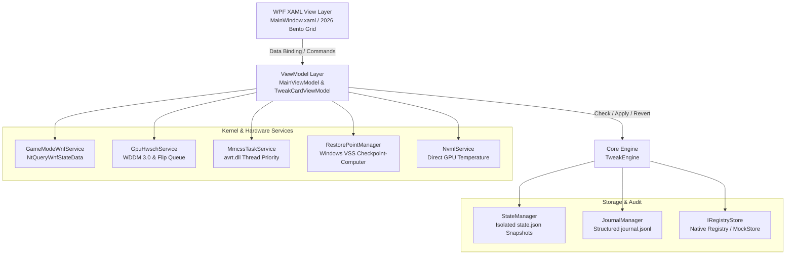

# AXIS Architecture & Internal Specifications

## 1. High-Level Architectural Model

AXIS follows a strictly separated, reactive architectural pattern designed for high determinism, sub-millisecond responsiveness, and zero runtime dependencies beyond Windows native APIs.

---

## 2. Component Layer Responsibilities

### 2.1 View Layer (`MainWindow.xaml`, `App.xaml`)
- Renders responsive 2026 Bento-grid views across 6 primary screens:
  - **Overview (Dashboard)**: Real-time telemetry, 60s load graph, specs passport, kernel subsystem cards.
  - **Tweaks (Catalog & Inspector)**: Virtualized item collection (`VirtualizingStackPanel.Recycling`) with expandable deep tweak inspector.
  - **Settings (Recovery Hub)**: Windows VSS restore points, `state.json` backup exports, telemetry polling toggles, ping host presets.
  - **Journal (Audit Log)**: Full chronological audit trail.
  - **History (Snapshots)**: Detailed view of captured system configuration states.
  - **About**: Architectural specifications, test status, and hotkey reference.
- Consumes pre-cached, frozen brushes (`_darkPalette`, `_lightPalette`) to achieve 0.10 ms theme toggle latency.

### 2.2 ViewModel Layer (`MainViewModel.cs`, `TweakCardViewModel.cs`)
- Exposes pure MVVM observable properties inheriting from `ObservableObject`.
- `TweakCardViewModel` queries live Windows registry values on demand via `TweakEngine.Store.GetValue(...)`, ensuring the UI displays true system state rather than assumed flags.
- Dispatches long-running operations (VSS restore point creation, ICMP ping, batch execution) to background tasks with smooth UI spinners.

### 2.3 Core Engine (`TweakEngine.cs`)
- Enforces defensive execution:
  1. **Pre-check**: Validates target Windows build compatibility (`min_build`) and user permissions.
  2. **Snapshot**: Records original registry state into `StateManager`.
  3. **Mutation**: Writes new values via `IRegistryStore`.
  4. **Post-read Verification**: Immediately queries the registry to confirm the physical write succeeded.
  5. **Audit Logging**: Emits structured log entries to `journal.jsonl`.

### 2.4 Storage & Isolation Layer
- **`IRegistryStore`**: Abstract interface allowing seamless switching between real Windows Registry (`RegistryStore`) and in-memory mock store (`MockRegistryStore`).
- **`StateManager`**: Manages `state.json`. All writes use atomic temporary file creation followed by atomic replacement to prevent file corruption during unexpected power outages.
- **`JournalManager`**: Appends audit log entries in JSON Lines format (`journal.jsonl`) for transparent forensic tracking.

---

## 3. Kernel Subsystems & WinAPI Services

### 3.1 Windows Notification Facility (WNF)
- Class: `GameModeWnfService`
- Interacts with undocumented Windows kernel WNF state names:
  - `WNF_RM_GAME_MODE_ACTIVE` (`0x41C6033FA3BC1075UL`): Tracks the process ID of active full-screen games.
  - `WNF_SEB_GAME_MODE` (`0x41840B3EA3BDD875UL`): Queries the active Game Mode power policy state.

### 3.2 WDDM 3.0 Hardware-Accelerated GPU Scheduling (HAGS) & Flip Queue
- Class: `GpuHwschService`
- Decodes driver capability bitmasks in `HKLM\SYSTEM\CurrentControlSet\Control\GraphicsDrivers` to verify hardware flip queue readiness and WDDM 2.9/3.0 driver support.

### 3.3 Multimedia Class Scheduler Service (MMCSS)
- Class: `MmcssTaskService`
- Queries `SystemProfile` registry keys (`SystemResponsiveness`, `NetworkThrottlingIndex`) and invokes `avrt.dll` (`AvSetMmThreadCharacteristicsW`) to verify multimedia priority elevation for audio and game threads.
