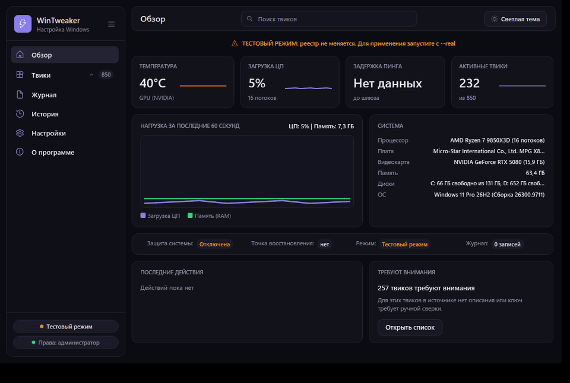
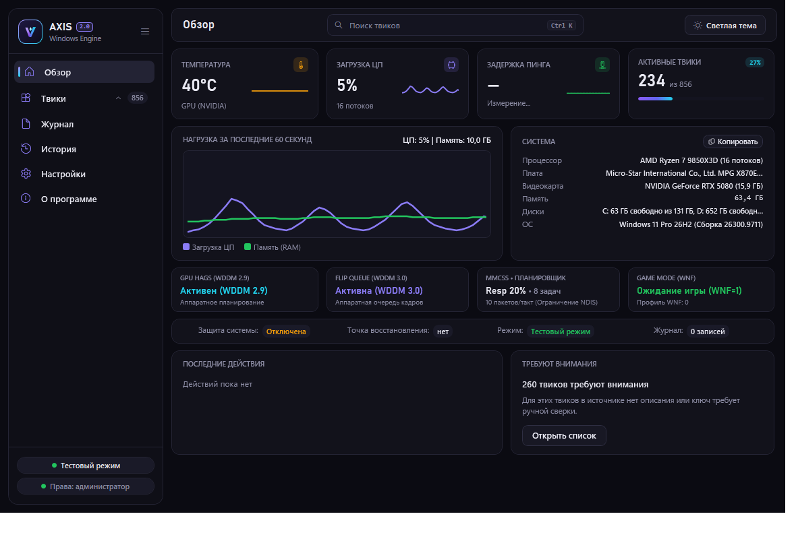
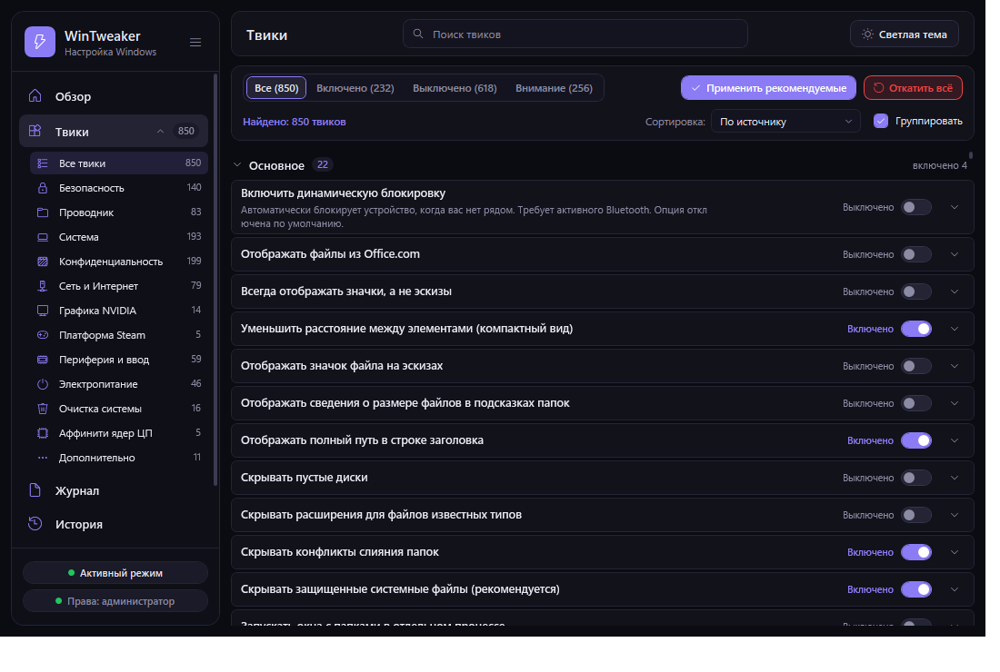
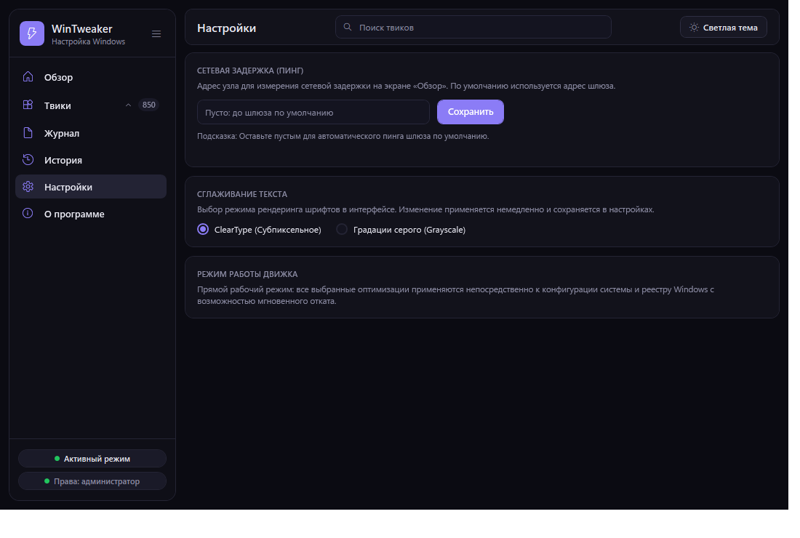

# ⚡ WinTweaker

> **Быстрый, автономный и безопасный твикер Windows 10 / 11 с нативной аппаратной телеметрией и каталогом из 851 тонких настроек.**



---

## 🎯 Быстрый старт для новичков (в 3 простых шага)

Вам не нужно разбираться в коде или реестре — всё работает прямо «из коробки»:

1. **Скачайте программу**:
   Перейдите в раздел **[Релизы (Releases)](https://github.com/Vektor010/win-tweaker/releases/latest)** и скачайте один файл **`Tweaker.exe`**.
2. **Запустите файл**:
   - При обычном запуске активируется **Безопасный тестовый режим**: вы можете свободно переключать твики, изучать описания и смотреть телеметрию — физический реестр Windows не меняется.
3. **Примените настройки**:
   - Нажмите кнопку **`[Применить рекомендуемые]`** для автоматического выбора оптимальных киберспортивных параметров.
   - Чтобы применить их в систему, запустите программу от имени Администратора:
     ```cmd
     Tweaker.exe --real
     ```
   - Любое действие можно в любой момент **откатить в 1 клик** кнопкой `[↺ Откатить всё]`.

---

## 📸 Скриншоты интерфейса

### 1. Мониторинг системы и аппаратная телеметрия
*Прямой опрос системных датчиков в реальном времени: нагрузка ЦП и ОЗУ за 60 секунд, температура видеокарты через NVML и сетевой пинг до шлюза.*


### 2. Каталог из 851 твика системы
*Компактный список твиков высокой плотности: клик в любом месте строки для подробностей, индикация рисков и моментальные подсказки.*


### 3. Мгновенный поиск без сдвига интерфейса
*Быстрая фильтрация по названию, описанию или целевой службе.*


### 4. Тонкая настройка и выбор режимов
*Настройка хоста пинга, субпиксельного сглаживания текста (ClearType / Grayscale) и переключение светлой/тёмной темы Tokyo Night.*


---

## 🧭 Что умеет оптимизировать WinTweaker?

| Категория | Количество | Что делает понятными словами |
| :--- | :---: | :--- |
| 🛡️ **Безопасность** | 140 | Изоляция системных процессов, динамическая блокировка, настройка Защитника Windows. |
| 📁 **Проводник** | 83 | Компактный вид папок, удаление ненужных пунктов контекстного меню, быстрый поиск. |
| ⚙️ **Система** | 193 | Приоритезация игровых задач (MMCSS), разгрузка шедулера, снижение лагов интерфейса. |
| 🔒 **Конфиденциальность** | 199 | Отключение фоновой телеметрии, диагностических отчётов, маяков и скрытого сбора данных. |
| 🌐 **Сеть и Интернет** | 79 | Алгоритмы TCP BBR/CUBIC, отключение задержки Nagle, мгновенный сброс кэша DNS. |
| 🎮 **Графика NVIDIA** | 14 | Управление D3D/DXGI Flip Queue, запуск панели NVIDIA строго по требованию. |
| 🕹️ **Клиент Steam** | 5 | Отключение встроенного веб-хелпера CEF и сглаживания шрифтов для снижения фоновой нагрузки. |
| 🖱️ **Периферия и ввод** | 59 | Нулевой инпут-лаг, прямое считывание 1:1 для мыши и клавиатуры без сглаживания. |
| ⚡ **Электропитание** | 46 | Отключение скрытой парковки ядер, схема Ultimate Performance, таймеры точности. |
| 🗑️ **Очистка системы** | 16 | Экспресс-очистка временных файлов, кэша шейдеров DirectX, корзины и истории сети. |
| 🧠 **Аффинити ядер ЦП** | 5 | Изоляция Core 0 для системных прерываний, устранение микрофризов и просадок 1% Low FPS. |

---

## 📜 50 готовых PowerShell-скриптов

Для пользователей, предпочитающих автоматизацию или работу в терминале, в папке **[`scripts/`](scripts/)** доступны 50 готовых автономных скриптов:
- Игровые профили для **CS2**, **Valorant**, **Fortnite**, **Overwatch**, **Marvel Rivals**.
- Готовые утилиты для очистки, бэкапа и восстановления системы.
- Полное руководство по каждому скрипту: **[scripts/README.md](scripts/README.md)**.

---

## ❓ Частые вопросы (FAQ)

<details>
<summary><b>1. Безопасно ли использовать WinTweaker?</b></summary>
<br>
Да. Приложение по умолчанию открывается в безопасном тестовом режиме и не производит никаких изменений в операционной системе. Каждый твик протестирован по первоисточникам и имеет строго определённое значение для безопасного отката (Default value).
</details>

<details>
<summary><b>2. Как вернуть всё назад, если мне не понравился результат?</b></summary>
<br>
В правом верхнем углу списка твиков нажмите красную кнопку <b>[↺ Откатить всё]</b>, либо переключите любой отдельный твик в обратное положение. Все ключи реестра вернутся к заводским значениям по умолчанию.
</details>

<details>
<summary><b>3. Нужно ли устанавливать программу?</b></summary>
<br>
Нет. WinTweaker — это один автономный переносимый (portable) EXE-файл размером всего около 1 МБ. Его можно запускать с флешки или из любой удобной папки.
</details>

<details>
<summary><b>4. Требуется ли перезагрузка компьютера?</b></summary>
<br>
Большинство твиков Проводника, сети и приложений применяются мгновенно. Для низкоуровневых параметров ядра и сетевого стека рекомендуется перезагрузить ПК один раз после завершения настройки.
</details>

---

## 🛠️ Разработчикам и ИИ-агентам

- **Сборка проекта**:
  ```powershell
  powershell -ExecutionPolicy Bypass -File .\build.ps1
  ```
- **Запуск тестов (12 тест-сьюитов, 7660 тестов)**:
  ```cmd
  dist\Tests.exe
  ```
- **Инструкции для ИИ-ассистентов**:
  Архитектура, стек C# 5.0, палитра Tokyo Night и технические правила подробно описаны в файле **[`AI_INSTRUCTIONS.md`](AI_INSTRUCTIONS.md)** и **[`.cursorrules`](.cursorrules)**.

---

## 📄 Лицензия

Проект распространяется под открытой лицензией [MIT](LICENSE).
