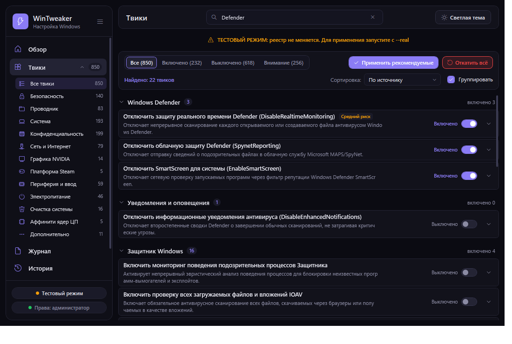
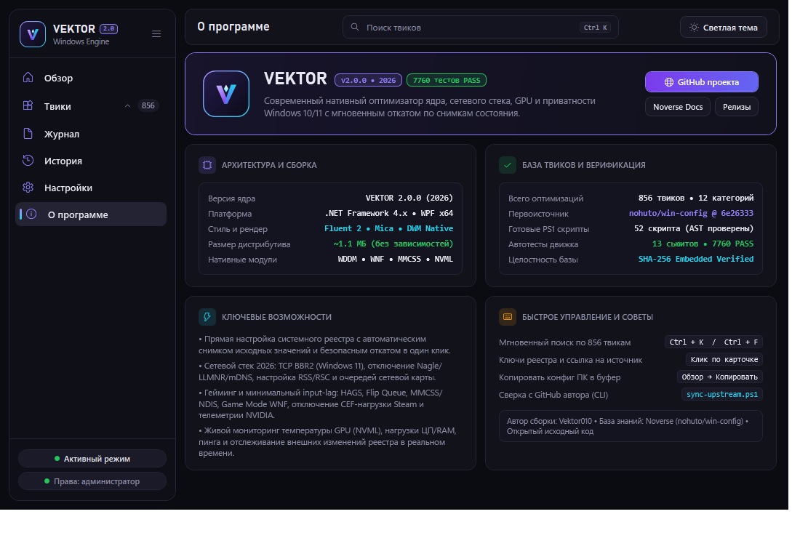

# ⚡ AXIS — Zero-Latency Windows 10/11 Optimizer (2026 Edition)

[](https://github.com/Vektor010/axis/releases)
[](tests/)
[](data/tweaks.json)
[](dist/Axis.exe)
[](LICENSE)

> **AXIS** — современный, автономный соревновательный оптимизатор ядра, видеоподсистемы (WDDM/NVML), сетевого стека (TCP BBR2) и приватности Windows 10/11.
> Создан для достижения **минимального input-lag**, стабильного фреймтайма и нулевых системных задержек DPC с гарантированным **100% безопасным откатом** по снимкам состояния системы.

---

## 🎯 Быстрый старт для новичков (в 2 клика)

Вам не нужно разбираться в коде или реестре — программа автономна и готова к работе сразу после загрузки:

1. **Скачайте программу**:
   Перейдите в раздел **[Релизы (Releases)](https://github.com/Vektor010/axis/releases/latest)** и скачайте один компактный файл **`Axis.exe`** (~1.2 МБ).
2. **Запустите `Axis.exe`**:
   - Программа запускается напрямую с правами администратора.
   - Никаких скрытых установок, зависимостей или фонового мусора — чистый C# / WPF с аппаратным ускорением DWM.
3. **Оптимизируйте систему в 1 клик**:
   - Нажмите **`[Применить рекомендуемые]`** — программа безопасно применит пакет из 233 проверенных киберспортивных твиков, сохранив точные снимки исходных значений реестра.
   - Любое изменение можно мгновенно **вернуть назад в 1 клик** кнопкой **`[↺ Откатить всё]`** или переключением конкретного твика.

---

## 📸 Скриншоты интерфейса

### 1. Мониторинг системы и аппаратная телеметрия
*Прямой опрос системных датчиков в реальном времени: нагрузка ЦП и ОЗУ за 60 секунд, температура видеокарты через нативный драйвер NVML, сетевой пинг и тайминги.*


### 2. Каталог из 856 твиков системы
*Компактный список твиков высокой плотности: клик в любом месте строки для подробностей, индикация рисков и моментальные подсказки.*


### 3. Мгновенный поиск без сдвига интерфейса (Ctrl+K)
*Быстрая фильтрация по названию, описанию, ключу реестра или целевой службе.*


### 4. Экран «О программе» (Bento 2026)
*Полная верификация целостности базы, статус 7760 автотестов, проверка первоисточников и нативные модули WDDM/MMCSS.*


---

## 🧭 Каталог оптимизаций AXIS (856 параметров в 12 категориях)

| Категория | Количество | Что оптимизирует |
| :--- | :---: | :--- |
| ⚙️ **Система** | 193 | Приоритезация игровых задач (MMCSS), разгрузка шедулера, снижение лагов ядра Windows. |
| 🔒 **Конфиденциальность** | 199 | Отключение фоновой телеметрии, диагностических отчётов, маяков и скрытого сбора данных. |
| 🛡️ **Безопасность** | 140 | Изоляция системных процессов, динамическая блокировка, тонкая настройка Защитника Windows. |
| 📁 **Проводник** | 83 | Компактный вид папок, удаление ненужных пунктов контекстного меню, быстрый поиск. |
| 🌐 **Сеть и Интернет** | 79 | Алгоритмы TCP BBR2/CUBIC, отключение задержки Nagle, мгновенный сброс кэша DNS, RSS/RSC. |
| 🖱️ **Периферия и ввод** | 61 | Нулевой инпут-лаг, прямое считывание 1:1 для мыши и клавиатуры, оптимизация Logitech G HUB. |
| ⚡ **Электропитание** | 46 | Отключение скрытой парковки ядер, схема Ultimate Performance, прецизионные таймеры. |
| 🗑️ **Очистка системы** | 16 | Экспресс-очистка временных файлов, кэша шейдеров DirectX, корзины и истории сети. |
| 🎮 **Графика NVIDIA** | 14 | Управление D3D/DXGI Flip Queue, запуск панели NVIDIA строго по требованию. |
| 🕹️ **Клиент Steam** | 8 | Отключение встроенного веб-хелпера CEF, фонового аппаратного H.264 и автозапуска overlay. |
| 🧠 **Аффинити ядер ЦП** | 5 | Изоляция Core 0 для системных прерываний, устранение микрофризов и просадок 1% Low FPS. |
| 🛠️ **Разное (Misc/RTSS)** | 12 | Отключение фонового автозапуска RivaTuner Statistics Server (RTSS), системные твики. |

---

## 📜 52 готовых PowerShell-скрипта (scripts/)

Для продвинутых пользователей и скриптовой автоматизации в папке **[`scripts/`](scripts/)** доступны 52 автономных скрипта:
- Все 52 скрипта протестированы на корректность синтаксиса через PowerShell AST-парсер (0 ошибок).
- Игровые профили для **CS2**, **Valorant**, **Fortnite**, **Overwatch**, **Marvel Rivals**.
- Готовые утилиты для очистки кэша, бэкапа и восстановления системы.
- Полное руководство по каждому скрипту: **[scripts/README.md](scripts/README.md)**.

---

## ❓ Частые вопросы (FAQ)

<details>
<summary><b>1. Безопасно ли применять твики в AXIS?</b></summary>
<br>
Да, на 100%. При нажатии «Применить рекомендуемые» или включении любого отдельного параметра программа автоматически сохраняет точный снимок исходного состояния ключа реестра в локальный защищённый журнал. В любой момент можно вернуть всё назад в 1 клик.
</details>

<details>
<summary><b>2. Как откатить изменения, если захочу вернуть настройки системы назад?</b></summary>
<br>
В правом верхнем углу нажмите кнопку <b>[↺ Откатить всё]</b>, либо выключите любой конкретный твик. Все ключи реестра мгновенно вернутся к исходным системным значениям, зафиксированным до оптимизации.
</details>

<details>
<summary><b>3. Нужно ли устанавливать программу?</b></summary>
<br>
Нет. AXIS поставляется в виде одного переносимого (portable) EXE-файла <b>`Axis.exe`</b> размером всего ~1.2 МБ. Никаких инсталляторов — запускайте откуда угодно.
</details>

<details>
<summary><b>4. Требуется ли перезагрузка компьютера?</b></summary>
<br>
Большинство твиков Проводника, сети, Steam и периферии применяются сразу. Для параметров сетевого стека TCP BBR2 и планировщика ядра рекомендуется перезагрузить компьютер один раз после применения твиков.
</details>

---

## 🛠️ Разработчикам и ИИ-агентам

- **Сборка проекта (MSBuild)**:
  ```powershell
  powershell -ExecutionPolicy Bypass -File .\build.ps1
  ```
  *Генерирует флагманский бинарник `dist\Axis.exe` и `dist\Tweaker.exe`.*

- **Автоматизированное тестирование (7760 тестов, 13 сьюитов)**:
  ```cmd
  dist\Tests.exe
  ```

- **Комплексная верификация (AST, база 856 твиков, SHA-256 embed parity)**:
  ```powershell
  powershell -ExecutionPolicy Bypass -File .\verify-all.ps1
  ```

---

## 📄 Лицензия и первоисточники

- Автор сборки и архитектуры: **Vektor010**
- База знаний и первоисточники: **[Noverse (nohuto/win-config)](https://noverse.dev/docs/win-config/)**
- Лицензия: **[MIT](LICENSE)**
