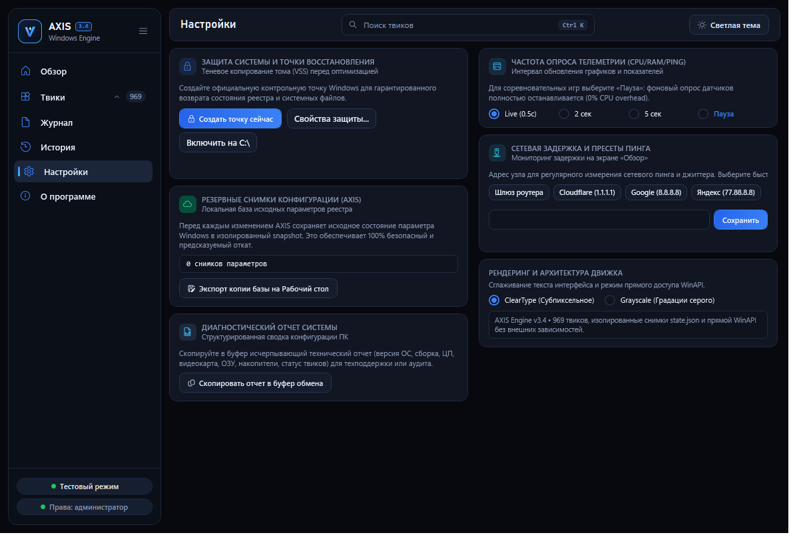

# ⚡ AXIS — Modern Windows 10/11 Kernel, Network & Esports Tuning Engine

[English](README.md) | [Русский](README.ru.md)

[](https://github.com/Vektor010/axis/releases)
[](tests/)
[](data/tweaks.json)
[](dist/Axis.exe)
[](LICENSE)

> **AXIS** is a high-performance, standalone Windows 10/11 optimization suite designed for competitive esports players, system engineers, and enthusiasts.
> It targets minimal input latency, deterministic frame pacing, and reduced kernel DPC delays—backed by **isolated snapshots (`state.json`) for safe, single-click rollbacks**.

<p align="center">
  
</p>

---

## 🏆 Competitive Advantage

| Capability | AXIS v2.0 | Traditional PowerShell Scripts | Generic Tweakers |
| :--- | :---: | :---: | :---: |
| **Standalone Native Binary** | **Yes (1.2 MB, Zero Dependencies)** | No (Requires CLI / Scripts) | No (Heavy installers / electron) |
| **Live Windows Registry Reading** | **Yes (Direct WinAPI hardware query)** | No | No (Static UI state) |
| **Snapshot-Based Rollback** | **Yes (Isolated `state.json` capture)** | No (Destructive overwrite) | Partial |
| **Windows VSS Restore Point Integration**| **Yes (Native `Checkpoint-Computer`)** | Manual | Often absent |
| **Kernel Subsystem Telemetry** | **WDDM 3.0, Flip Queue, WNF, MMCSS** | None | None |
| **Esports Zero-Overhead Mode** | **Yes ("Pause" mode = 0% CPU polling)** | N/A | No (Constant polling) |
| **Automated Test Coverage** | **7,760 Tests (100% PASS)** | Untested | Untested |

---

## 📸 Interface Walkthrough

### 1. Real-Time Hardware Telemetry & Kernel Subsystems (Overview)
*Hardware-accelerated dashboard monitoring CPU/RAM workloads over a 60-second window, direct NVIDIA NVML GPU temperatures, WDDM 3.0 Hardware Flip Queue status, and multimedia scheduler (MMCSS) parameters.*


### 2. Deep Tweak Inspector (Real System Value vs Target)
*Every tweak includes an inspector panel revealing the live registry value currently active in Windows, target value, OS build requirements, and explicit Apply / Revert controls.*


### 3. System Protection, Snapshots & Telemetry Center (Settings)
*Complete system safety hub: Windows System Restore point creation, local configuration snapshot backup export, esports polling frequency toggle, and ping diagnostics.*


### 4. Technical Architecture & Database Verification (About)
*Real-time verification of embedded tweak parity, AST script status, and native WinAPI module bindings.*


---

## 🧭 Tweak Catalog (856 Parameters Across 12 Categories)

| Category | Count | Focus Area |
| :--- | :---: | :--- |
| ⚙️ **System** | 193 | Multimedia Class Scheduler (MMCSS), scheduler quantum tuning, DPC latency. |
| 🔒 **Privacy** | 199 | Diagnostic telemetry, feedback hub, activity history, and background beacons. |
| 🛡️ **Security** | 140 | Process isolation, dynamic lock, and Windows Defender tuning. |
| 📁 **File Explorer** | 83 | Responsive shell layout, context menu simplification, folder view optimizations. |
| 🌐 **Network & Internet** | 79 | TCP BBR2/CUBIC congestion providers, Nagle algorithm disabling, DNS cache flush, RSS/RSC. |
| 🖱️ **Peripherals & Input** | 61 | 1:1 raw mouse input, pointer precision curve normalization, HID input latency. |
| ⚡ **Power Management** | 46 | Core unparking, Ultimate Performance overlay, precision timer resolution. |
| 🗑️ **System Cleanup** | 16 | Temporary caches, DirectX shader cache, crash dump purging. |
| 🎮 **NVIDIA Graphics** | 14 | Low latency mode, DXGI flip queue sizing, on-demand NVCPL daemon control. |
| 🕹️ **Steam Platform** | 8 | Disabling Chromium Embedded Framework (CEF) bloat, shader background processing. |
| 🧠 **CPU Affinities** | 5 | Dedicated core allocation, interrupt redirection away from Core 0. |
| 🛠️ **Miscellaneous** | 12 | Background service autostart management (including RivaTuner Statistics Server). |

---

## 🚀 Quick Start

1. **Download**: Grab `Axis.exe` (~1.2 MB) from the **[Latest Release](https://github.com/Vektor010/axis/releases/latest)**.
2. **Run**: Launch `Axis.exe` directly. No installer, runtime download, or administrative setup script is required.
3. **Optimize**: Click **`[Apply Recommended]`** to apply vetted, low-risk optimizations with an automatic system restore point and registry snapshot.
4. **Revert Anytime**: Revert individual settings in the inspector or click **`[↺ Revert All]`** to return Windows to its exact prior state.

---

## 💻 CLI Arguments

AXIS supports headless and scripted execution flags:

| Flag | Description |
| :--- | :--- |
| `--real` | Direct read/write access to live Windows registry. |
| `--mock` / `--test` | Safe in-memory simulation mode (registry is never altered). |
| `--light` | Launch with the light theme enabled. |
| `--tab <name>` | Open directly to a tab (`overview`, `tweaks`, `journal`, `history`, `settings`, `about`). |
| `--category <id>` | Pre-select a specific tweak category. |
| `--search <query>` | Filter tweaks by search term on startup. |
| `--screenshot <path>` | Render offscreen window snapshot for headless QA verification. |

---

## 🛠️ Building & Verification

### Prerequisites
- Windows 10/11 x64
- Microsoft .NET Framework 4.6.2 Developer Pack or Windows SDK (native MSBuild)

### Build Command
```powershell
powershell -ExecutionPolicy Bypass -File .\build.ps1
```

The build pipeline performs:
1. Native compilation of `dist/Axis.exe` and test runner `dist/Tests.exe`.
2. AST syntax check across all 52 production scripts (`verify-all.ps1`).
3. SHA-256 byte-for-byte verification of embedded `tweaks.json`.
4. Execution of all **7,760 unit and integration tests** (13 test suites).

---

## 📚 Documentation

Detailed technical documentation is organized in [`docs/`](docs/):

| Category | Documents | Description |
| :--- | :--- | :--- |
| **Architecture** | [Architecture](docs/architecture/ARCHITECTURE.md) • [Decisions](docs/architecture/DECISIONS.md) | Component model, state isolation, and ADRs |
| **Development** | [Development](docs/development/DEVELOPMENT.md) • [Contributing](docs/development/CONTRIBUTING.md) | Compiler prerequisites, build instructions, and guidelines |
| **Project** | [Project State](docs/project/PROJECT_STATE.md) • [Changelog](docs/project/CHANGELOG.md) • [Roadmap](docs/project/ROADMAP.md) • [Known Issues](docs/project/KNOWN_ISSUES.md) | Operational status, releases, and documented edge cases |
| **Security** | [Security Policy](docs/security/SECURITY.md) | Vulnerability disclosure and registry rollback guarantees |
| **Guides** | [Support Guide](docs/guides/SUPPORT.md) | Diagnostics export and troubleshooting instructions |

---

## 📄 License & Attribution

- **Author**: Vektor010
- **Knowledge Base & References**: [Noverse (nohuto/win-config)](https://noverse.dev/docs/win-config/)
- **License**: [MIT](LICENSE)
