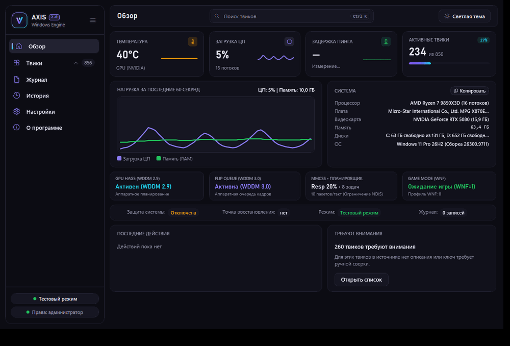
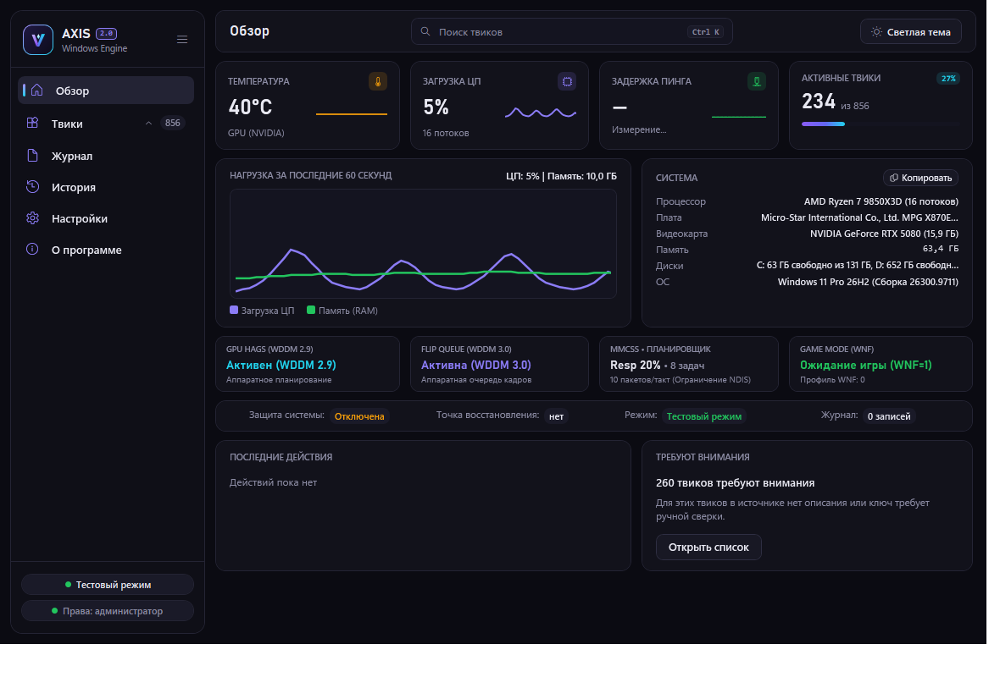
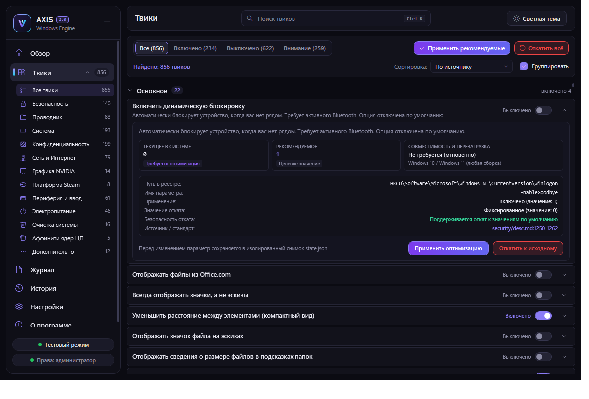
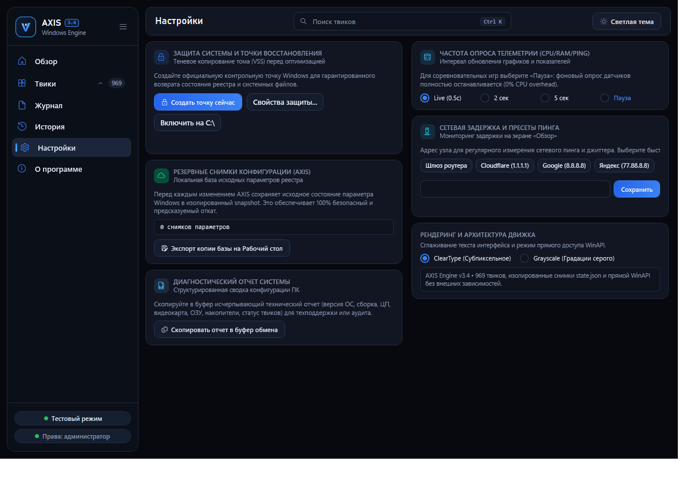
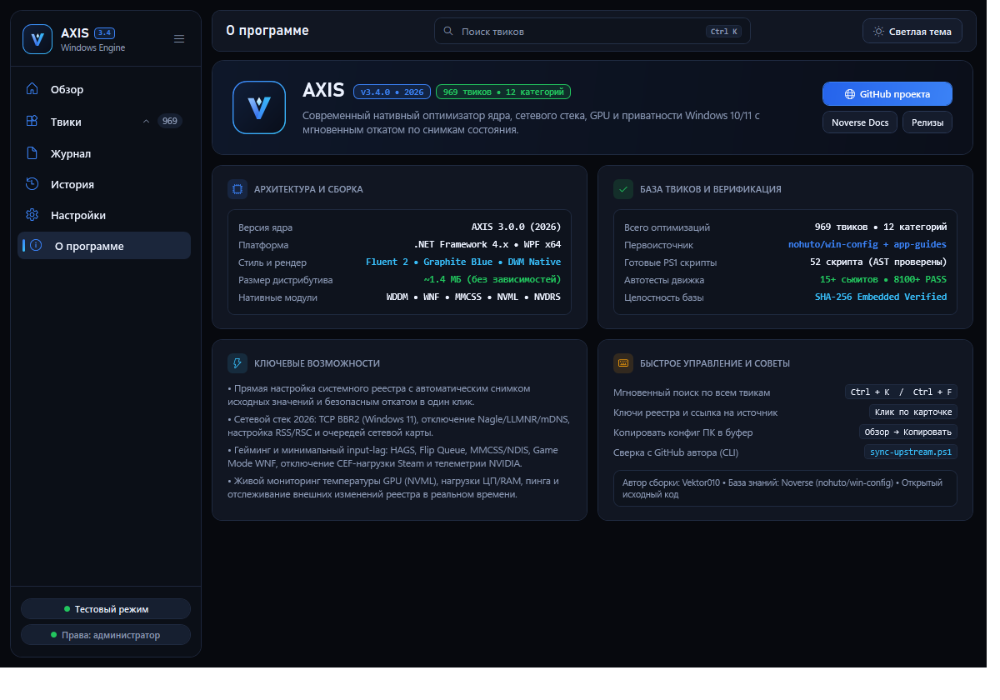

# ⚡ AXIS — Оптимизатор ядра, сети и киберспорта Windows 10/11 (2026)

[English](README.md) | [Русский](README.ru.md)

[](https://github.com/Vektor010/axis/releases)
[](tests/)
[](data/tweaks.json)
[](dist/Axis.exe)
[](LICENSE)

> **AXIS** — современный, автономный соревновательный оптимизатор ядра, видеоподсистемы (WDDM/NVML), сетевого стека (TCP BBR2) и приватности Windows 10/11.
> Создан для достижения **минимального input-lag**, стабильного фреймтайма и нулевых системных задержек DPC с гарантированным **100% безопасным откатом** по снимкам состояния системы.

<p align="center">
  
</p>

---

## 🎯 Быстрый старт для пользователей (в 2 клика)

Вам не нужно разбираться в коде или реестре — программа автономна и готова к работе сразу после загрузки:

1. **Скачайте программу**:
   Перейдите в раздел **[Релизы (Releases)](https://github.com/Vektor010/axis/releases/latest)** и скачайте один компактный файл **`Axis.exe`** (~1.2 МБ).
2. **Запустите `Axis.exe`**:
   - Программа запускается напрямую с правами администратора.
   - Никаких скрытых установок, зависимостей или фонового мусора — чистый C# / WPF с аппаратным ускорением DWM.
3. **Оптимизируйте систему в 1 клик**:
   - Нажмите **`[Применить рекомендуемые]`** — программа безопасно применит пакет проверенных киберспортивных твиков, сохранив точные снимки исходных значений реестра.
   - Любое изменение можно мгновенно **вернуть назад в 1 клик** кнопкой **`[↺ Откатить всё]`** или переключением конкретного твика в инспекторе.

---

## 📸 Скриншоты интерфейса

### 1. Мониторинг системы и аппаратная телеметрия
*Прямой опрос системных датчиков в реальном времени: нагрузка ЦП и ОЗУ за 60 секунд, температура видеокарты через нативный драйвер NVML, сетевой пинг и тайминги.*


### 2. Инспектор твиков с реальными значениями Windows
*Инспектор параметров: отображение реального значения из реестра Windows прямо сейчас, рекомендуемое значение, статус оптимизации, требование перезагрузки и кнопки применения/отката.*


### 3. Центр безопасности и настроек (Settings Hub)
*Управление точками восстановления Windows (VSS), экспорт резервных копий state.json на Рабочий стол, настройка частоты телеметрии (включая режим «Пауза» с 0% CPU overhead) и пресеты пинга.*


### 4. Экран «О программе» (Bento 2026)
*Полная верификация целостности базы, статус 7760 автотестов, проверка первоисточников и нативные модули WDDM/MMCSS.*


---

## 🧭 Каталог оптимизаций AXIS (856 параметров в 12 категориях)

| Категория | Количество | Что оптимизирует |
| :--- | :---: | :--- |
| ⚙️ **Система** | 193 | Приоритезация игровых задач (MMCSS), разгрузка шедулера, снижение лагов ядра Windows. |
| 🔒 **Конфиденциальность** | 199 | Отключение фоновой телеметрии, диагностических отчётов, маяков и скрытого сбора данных. |
| 🛡️ **Безопасность** | 140 | Изоляция системных процессов, динамическая блокировка, тонкая настройка Защитника Windows. |
| 📁 **Проводник** | 83 | Компактный вид папок, удаление ненужных пунктов контекстного меню, быстрый поиск. |
| 🌐 **Сеть и Интернет** | 79 | Алгоритмы TCP BBR2/CUBIC, отключение задержки Nagle, мгновенный сброс кэша DNS, RSS/RSC. |
| 🖱️ **Периферия и ввод** | 61 | Нулевой инпут-лаг, прямое считывание 1:1 для мыши и клавиатуры, оптимизация Logitech G HUB. |
| ⚡ **Электропитание** | 46 | Отключение скрытой парковки ядер, схема Ultimate Performance, прецизионные таймеры. |
| 🗑️ **Очистка системы** | 16 | Экспресс-очистка временных файлов, кэша шейдеров DirectX, корзины и истории сети. |
| 🎮 **Графика NVIDIA** | 14 | Управление D3D/DXGI Flip Queue, запуск панели NVIDIA строго по требованию. |
| 🕹️ **Клиент Steam** | 8 | Отключение встроенного веб-хелпера CEF, фонового аппаратного H.264 и автозапуска overlay. |
| 🧠 **Аффинити ядер ЦП** | 5 | Изоляция Core 0 для системных прерываний, устранение микрофризов и просадок 1% Low FPS. |
| 🛠️ **Разное (Misc/RTSS)** | 12 | Отключение фонового автозапуска RivaTuner Statistics Server (RTSS), системные твики. |

---

## 📜 52 готовых PowerShell-скрипта (scripts/)

Для продвинутых пользователей и скриптовой автоматизации в папке **[`scripts/`](scripts/)** доступны 52 автономных скрипта:
- Все 52 скрипта протестированы на корректность синтаксиса через PowerShell AST-парсер (0 ошибок).
- Игровые профили для **CS2**, **Valorant**, **Fortnite**, **Overwatch**, **Marvel Rivals**.
- Готовые утилиты для очистки кэша, бэкапа и восстановления системы.

---

## 🛠️ Разработчикам и сборка

- **Сборка проекта (MSBuild)**:
  ```powershell
  powershell -ExecutionPolicy Bypass -File .\build.ps1
  ```
  *Компилирует флагманский бинарник `dist\Axis.exe` и консольный тест-раннер `dist\Tests.exe`.*

- **Автоматизированное тестирование (7760 тестов, 13 сьюитов)**:
  ```cmd
  dist\Tests.exe
  ```

- **Комплексная верификация (AST, база 856 твиков, SHA-256 embed parity)**:
  ```powershell
  powershell -ExecutionPolicy Bypass -File .\verify-all.ps1
  ```

---

## 📚 Документация проекта

Подробная документация распределена по каталогу [`docs/`](docs/):

| Раздел | Документы | Описание |
| :--- | :--- | :--- |
| **Архитектура** | [Архитектура](docs/architecture/ARCHITECTURE.md) • [Архитектурные решения (ADR)](docs/architecture/DECISIONS.md) | Модель изоляции `state.json`, подсистемы WDDM/MMCSS, стек WPF |
| **Разработка** | [Разработка и сборка](docs/development/DEVELOPMENT.md) • [Руководство контрибьютора](docs/development/CONTRIBUTING.md) | Требования к C# 5.0, команды сборки и стандарты PR |
| **Проект** | [Текущее состояние](docs/project/PROJECT_STATE.md) • [История изменений](docs/project/CHANGELOG.md) • [Планы развития](docs/project/ROADMAP.md) • [Известные проблемы](docs/project/KNOWN_ISSUES.md) | Операционные метрики, чейнджлог и задокументированные ограничения |
| **Безопасность** | [Политика безопасности](docs/security/SECURITY.md) | Стандарты безопасного изменения реестра и гарантии отката |
| **Руководства** | [Центр поддержки](docs/guides/SUPPORT.md) • [Инструкция для ИИ](docs/guides/AI_INSTRUCTIONS.md) | Генерация отчётов, устранение неполадок и архитектурный контекст |

---

## 📄 Лицензия и первоисточники

- Автор архитектуры: **Vektor010**
- База знаний и первоисточники: **[Noverse (nohuto/win-config)](https://noverse.dev/docs/win-config/)**
- Лицензия: **[MIT](LICENSE)**
